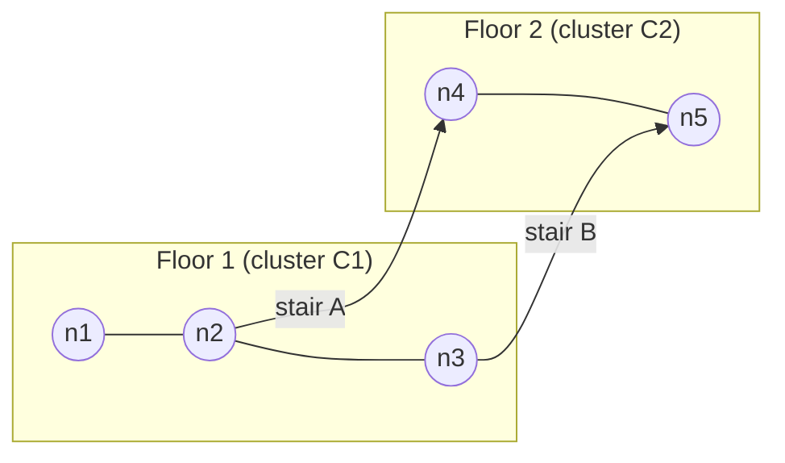
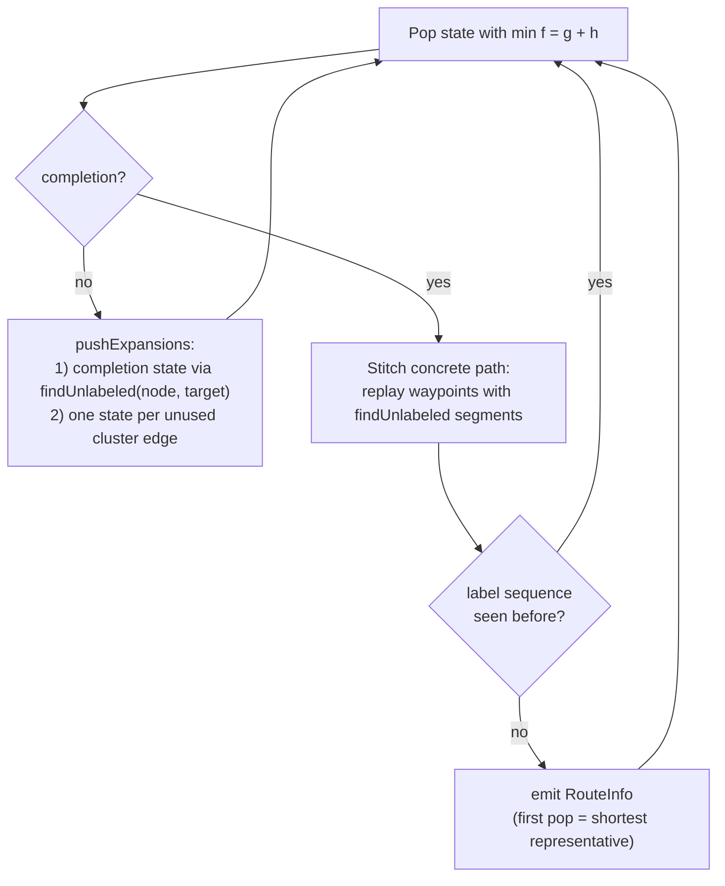
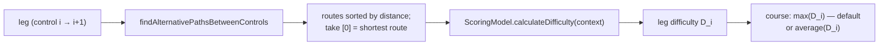

# Route Analyzer — Algorithm Reference

This document describes the three core algorithm families implemented in
[`packages/core/src/route-analyzer.ts`](../../packages/core/src/route-analyzer.ts)
and its supporting modules:

1. **Shortest path** — Dijkstra's algorithm over the venue graph.
2. **Path enumeration** — two strategies: a heuristic *iterative penalty* method
   (`findAlternativePaths`) and an exhaustive *best-first enumeration* of all
   distinct routes (`findAllAlternativePathsBetweenControls`).
3. **Difficulty calculation** — the pluggable scoring-model architecture and the
   Alpha model, built on branching-point, decision-point, and dead-end analysis.

The intended reader is a developer familiar with graphs, priority queues, and
basic algorithm analysis. Every claim is traceable to the referenced source files.

---

## 1. The Venue Graph Model

Indoor orienteering venues (multi-floor buildings) are modeled as a directed
multigraph. The primitives are defined in
[`packages/core/src/models/graph.ts`](../../packages/core/src/models/graph.ts):

```ts
export interface Node extends MapPosition {
  id: string;
  x: number;   // map coordinates in millimeters (paper space)
  y: number;
}

export interface Edge {
  from: string;
  to: string;
  label: string;          // non-empty for stairs/ramps; empty for corridors
  reverseLabel?: string;  // label when traversed backwards (e.g. "A up" / "A down")
  oneWay?: boolean;       // directed edge if true
  ignoreLength?: boolean; // zero geometric length (stairs)
}
```

Three edge properties drive all of the algorithms below:

| Property | Meaning | Algorithmic consequence |
|---|---|---|
| `label` | Visible name of a stair/ramp crossing | Defines route *identity* — two routes are "the same" iff they cross the same labeled edges in the same order |
| `oneWay` | Directed constraint | Edge is traversable only `from → to` |
| `ignoreLength` | Stairs; length not measured on the map | Edge weight is **0 m** in every distance computation |

**Controls** (start, finish, numbered control points) are merged into the node
set at `RouteAnalyzer` construction time (`route-analyzer.ts`, constructor), so
pathfinding treats them as ordinary graph nodes.

**Levels** are not stored on nodes. Instead, each floor is described by a
`Polygon` with a `level` (and optionally `elevation`) attribute. The floor of a
node is resolved by point-in-polygon lookup (`findPolygonForPoint`). An edge
whose endpoints resolve to different levels is a **level-change edge** — this
is how "stairs" are detected semantically, independent of the `ignoreLength`
flag (`scoring-models/base.ts`, `isLevelChangeEdge`).

**Distances.** Map coordinates are millimeters on paper. Real-world meters are
obtained by scaling:

$$d = \text{hypot}(\Delta x, \Delta y) \cdot \text{mapScale} \cdot 0.001$$

implemented in `calculateEdgeDistanceMeters`
([`route-geometry.ts`](../../packages/core/src/route-geometry.ts); `RouteAnalyzer`
exposes it as a thin private wrapper supplying `this.mapScale`). For
`ignoreLength` edges the geometric term is skipped entirely, so a staircase
contributes 0 m to route length. An optional per-edge multiplicative *penalty*
map can inflate weights — this hook powers the iterative penalty method
(Section 3).

For O(1) access the analyzer pre-builds four lookup structures in its
constructor: `nodeControlMap` (id → object), `edgeLookup` (`"from:to"` → edge,
both directions for bidirectional edges), `controlNodeMap` (control → graph
node), and `nodeEdges` (node → incident edges).

---

## 2. Shortest Path — Dijkstra's Algorithm

### 2.1 Main implementation (`dijkstra`)

`RouteAnalyzer.dijkstra(startNodeId, endNodeId, penalties?)` is a thin wrapper
around `findShortestPath(startNodeId, endNodeId, ctx)` in
[`packages/core/src/route-search.ts`](../../packages/core/src/route-search.ts),
passing a `ShortestPathContext` (this analyzer's edges, node resolver,
edge-distance function, and visualizer hooks). `findShortestPath` builds a
weighted adjacency list and runs the actual search — a textbook Dijkstra
with non-negative weights, extracted as plain functions with no dependency
on `RouteAnalyzer` state so it can be unit-tested standalone
(`route-search.test.ts`):

1. **Adjacency list construction** (`buildAdjacencyList`): every edge is
   converted to `Map<nodeId, Map<neighborId, weight>>`. Bidirectional edges
   produce entries in both directions; parallel edges are collapsed by keeping
   the minimum weight per node pair. `findShortestPath`'s `ctx.edgeDistanceMeters`
   is `RouteAnalyzer.dijkstra`'s closure over `calculateEdgeDistanceMeters` and
   any penalties — `buildAdjacencyList` itself is penalty-agnostic.
2. **Relaxation loop**: repeatedly extract the unvisited node with minimum
   tentative distance, relax its neighbors, and record `previous` pointers.
   The loop terminates early when the target is extracted or when the minimum
   distance is `Infinity` (target unreachable).
3. **Path reconstruction** (`reconstructPath`): walk `previous` pointers
   backwards from the target; return `null` if the chain does not reach the
   start.

The minimum extraction is a **linear scan** over the unvisited set, giving
O(V²) overall. As the source comment notes, this is a deliberate simplicity
trade-off — venue graphs have at most a few hundred nodes, where O(V²) is
indistinguishable from the heap-based O((V+E) log V) bound in practice.

Two properties of the weight function matter for correctness elsewhere:

- **Stairs are free.** `ignoreLength` edges weigh 0 m, so the minimum-*cost*
  path is not necessarily the path a human would call "shortest" — it may take
  a detour through stairs that cost nothing.
- **Penalties are keyed on the forward direction.** A penalty for edge
  `(u, v)` is stored under `"u:v"` and applied whichever direction the edge is
  traversed. This is intentional: penalizing a staircase should discourage its
  reuse in *either* direction. Because `buildAdjacencyList` is
  penalty-agnostic, this logic lives entirely in `calculateEdgeDistanceMeters`
  (`route-geometry.ts`), not in `route-search.ts`.

### 2.2 Heap-based variants

Two additional Dijkstra instances inside `findAllAlternativePathsBetweenControls`
use the generic binary min-heap from
[`packages/core/src/utils/binary-heap.ts`](../../packages/core/src/utils/binary-heap.ts)
(standard array-backed sift-up/sift-down, O(log n) push/pop), achieving the
classic O((V+E) log V) bound:

- `findUnlabeled(from, to)` — shortest path restricted to **unlabeled** edges,
  memoized per `(from, to)` pair.
- The **heuristic pre-pass** — a single Dijkstra on the *reversed* full graph
  from the target, yielding `h(n)` = exact shortest distance from `n` to the
  target (Section 4.3).

Both use lazy deletion (a `visited` set) instead of decrease-key.

### 2.3 Which "shortest path" is authoritative?

`shortestRouteBetweenControls(from, to)` — the route that every difficulty
score, UI list, and CLI report is based on — is **not** the raw `dijkstra`
result. It is defined as the first element of
`findAlternativePathsBetweenControls(from, to)`, i.e. the enumerated
alternative with the smallest geometric distance:

```ts
// route-analyzer.ts
shortestRouteBetweenControls(fromControl: Control, toControl: Control): RouteInfo | undefined {
  // findAlternativePathsBetweenControls returns routes sorted by ascending distance.
  return this.findAlternativePathsBetweenControls(fromControl.id, toControl.id)[0];
}
```

The docstring is explicit about why: `dijkstra` treats stairs as length-free
and may pick a different path than the distance-sorted route list shown in the
UI. Routing every consumer through this single method keeps the core library,
web app, and CLI tools scoring the *same* route (see commit
`fix(core): score leg difficulty against the shortest route consistently`).

---

## 3. Alternative Paths — Iterative Penalty Method

`findAlternativePaths(start, end, k)` produces a ranked list of route
alternatives. It is a *k-shortest-paths heuristic* in the spirit of penalty
methods (as opposed to exact algorithms like Yen's): rather than systematically
excluding edges, it makes previously used edges progressively more expensive
and re-runs Dijkstra.

```
paths ← ∅ ; penalties ← ∅
repeat up to 200 times, until max(k, 50) paths found:
    P ← dijkstra(start, end, penalties)
    if P is new (by node-sequence string) → emit RouteInfo(P)
    for each edge e on P:
        factor ← 5.0 if e is a level-change edge else 1.2
        penalties[e] ← (penalties[e] or 1.0) × factor
sort emitted paths by true (unpenalized) distance
```

Key design points (`route-analyzer.ts`, `findAlternativePaths`):

- **Multiplicative, accumulating penalties.** Each iteration multiplies the
  penalty of every edge on the found path, so repeatedly found paths become
  exponentially expensive and the search is pushed into different corridors.
- **Stairs are penalized ~4× harder (5.0 vs 1.2).** Level-change edges
  (detected by comparing the polygon levels of the endpoints) dominate route
  identity indoors, so the method aggressively diversifies stair choice while
  tolerating minor corridor variations.
- **Penalties are applied even when a duplicate path is found** — this is what
  eventually forces the search out of a local minimum instead of looping.
- **Results are re-sorted by real distance**, since the discovery order
  reflects penalized costs, not true lengths.

The method is fast and produces good candidates, but it is **not exhaustive**
and offers no completeness guarantee — which motivates the algorithm in the
next section.

---

## 4. Exhaustive Enumeration — `findAllAlternativePathsBetweenControls`

This is the most involved algorithm in the analyzer. It enumerates **all
routes with distinct visible label sequences** between two controls, shortest
first, with optional distance cutoffs. Full API details are in the companion
document [route-enumeration-all-paths.md](route-enumeration-all-paths.md);
this section focuses on how and why the algorithm works.

### 4.1 Problem statement

Enumerating all simple paths in a graph is exponential and mostly
uninteresting: two paths that wiggle through different corridors of the same
floor are, for orienteering purposes, the *same route*. The meaningful
identity of an indoor route is its **sequence of labeled crossings** (stairs,
ramps). So the problem becomes:

> Enumerate all distinct sequences of labeled-edge crossings that lead from
> control A to control B, and for each sequence produce the shortest concrete
> node path realizing it.

### 4.2 Graph condensation via Union–Find

Bidirectional unlabeled edges (ordinary corridors) never contribute to route
identity — within a flat region you can always take the cheapest corridor
path. The algorithm therefore collapses every connected component of the
"bidirectional unlabeled" subgraph into a single **cluster** using a
disjoint-set (Union–Find) structure with path compression. The structure
itself is a shared `UnionFind` class in
[`packages/core/src/utils/union-find.ts`](../../packages/core/src/utils/union-find.ts)
(with its own unit tests) — both `findAllAlternativePathsBetweenControls`
below and the human-route-planning simulation, `findHumanRouteBetweenControls`
(not otherwise covered in this document — see
[`planning/07-human-route-simulation.md`](../../planning/07-human-route-simulation.md)
and the companion article,
[`docs/article/human-route-finding.tex`](../article/human-route-finding.tex)),
build their own cluster graph over one shared `UnionFind` instance each,
rather than each re-implementing the disjoint-set logic:

```ts
// route-analyzer.ts, Phase 1
const uf = new UnionFind();
for (const edge of this.edges) {
  if ((!edge.label || edge.label === '') && !edge.oneWay) {
    uf.union(edge.from, edge.to);
  }
}
```

One-way unlabeled edges are deliberately **excluded** from the merge: merging
them would erase their directionality, and intra-cluster movement must be
bidirectionally reachable for the stitching step to be valid. Instead they
become directed cluster-graph edges with an empty label.

The **cluster graph** (Phase 2) then has one node per cluster and one directed
edge per traversable direction of each labeled or one-way-unlabeled edge:

```ts
interface ClusterEdge {
  toCluster: string;
  label: string;     // reverseLabel is used for the backward direction
  fromNode: string;  // concrete entry node on the source side
  toNode: string;    // concrete exit node on the destination side
  edgeId: string;    // shared by both directions of one physical edge
}
```

The shared `edgeId` enforces the rule *each physical staircase may be used at
most once per route (in either direction)*. This single constraint bounds the
search space and prevents infinite loops, while still allowing a route to
revisit the same *cluster* via different stairs — a real phenomenon in
multi-floor venues.



*Corridors `n1–n2–n3` and `n4–n5` collapse into clusters C1 and C2; the
cluster graph has exactly two edges, "A" and "B". The two distinct routes
C1→C2 are the label sequences `[A]` and `[B]`, regardless of which corridors
are walked.*

### 4.3 Exact A\* heuristic

Before the search starts, one Dijkstra run on the **reversed full graph**
(all edges, labeled and unlabeled) from the target computes

$$h(n) = \text{true shortest distance from } n \text{ to the target}.$$

Because `h` is the *exact* remaining distance ignoring only the
used-edge constraints, it is **admissible** (never overestimates) and
**consistent**. Consequently, states are popped from the priority queue in
non-decreasing order of true total route length — the property that makes both
the "shortest first" output order and the deduplication rule (Section 4.5)
correct.

### 4.4 Best-first search over label sequences

The search state captures everything that distinguishes partial routes:

```ts
interface SearchState {
  node: string;                            // current concrete node
  g: number;                               // exact stitched distance so far
  f: number;                               // g + h(node) — heap priority
  usedEdgeIds: Set<string>;                // physical labeled edges consumed
  waypoints: Array<{ from: string; to: string }>; // ordered crossings
  completion: boolean;                     // true ⇒ route ends here
}
```

A binary min-heap ordered by `f` drives the loop. Expanding a state at node
`N` (`pushExpansions`) pushes:

1. **A completion state** — if `findUnlabeled(N, target)` succeeds, a state
   with `f = g + d_unlabeled(N, target)` representing "stop crossing stairs
   and walk to the finish". At the target `h = 0`, so `f = g` is the exact
   final route length.
2. **One expansion per unused cluster edge** out of `find(N)` — the cost is
   the exact unlabeled shortest path from `N` to the stair entry `e.fromNode`,
   plus the crossing length of the stair itself (usually 0 m for
   `ignoreLength` stairs), and the priority adds `h(e.toNode)`.

Note that `g` is always an *exact stitched distance*, not an estimate — the
memoized unlabeled Dijkstra (`findUnlabeled`) supplies real intra-cluster
distances at expansion time. The heuristic only fills in the *future*.



### 4.5 Stitching and deduplication

When a completion state is popped, the concrete node path is assembled by
replaying the waypoints: for each crossing `(from, to)`, append the cached
unlabeled shortest path from the cursor to `from`, then step across to `to`;
finally append the unlabeled path to the target.

Routes are then deduplicated by their **visible label sequence** —
`getRouteLabels(path).join(',')`, which skips empty labels. Two subtle
consequences, both intentional:

- Routes crossing the same stairs via different *one-way corridors* share a
  label sequence and are reported once.
- Because states pop in non-decreasing true-distance order, **the first
  completion popped for a given label sequence is its shortest realization**;
  later duplicates are simply skipped.

### 4.6 Guards and pruning

| Guard | Value | Purpose |
|---|---|---|
| `usedEdgeIds` | per-state | Each physical labeled edge at most once per route |
| `MAX_LABEL_DEPTH` | 25 | Cap on crossings per route (stairs cost 0 m, so depth is not distance-bounded) |
| `MAX_POPS` | 500 000 | Hard CPU bound on heap pops |
| `maxResults` | caller (default 1000) | Emission cap; logs a warning if hit with work remaining |
| `distanceCutoff` | optional | Prunes states beyond `max(ratio · h(start), h(start) + absoluteMeters)` |

### 4.7 Complexity

Let `V`, `E` be graph size, `L` the number of cluster-graph edges (labeled +
one-way unlabeled), `R` the number of distinct label sequences emitted, and
`S` the average crossings per route.

- Union–Find and cluster-graph construction: ~O(E α(V)).
- Heuristic pre-pass: O((V+E) log V), once.
- `findUnlabeled`: O((V+E) log V) per distinct `(from, to)` pair, memoized —
  the set of endpoints is small (stair entries/exits plus the two controls).
- Main search: each emitted route corresponds to O(S) expansions, each pushing
  up to `L` successors; with heap cost this is roughly O(R · S · L · log Q)
  where `Q` is the queue size.

The exponential worst case (subsets of labeled edges) is real but irrelevant
in practice: venues have on the order of 10–20 stair edges, and the combined
`usedEdgeIds` / depth / cutoff constraints keep `R` in the hundreds.

---

## 5. Difficulty Calculation

### 5.1 Architecture: pluggable scoring models

Difficulty scoring is isolated behind an abstract `ScoringModel`
([`scoring-models/base.ts`](../../packages/core/src/scoring-models/base.ts))
with a static `ScoringModelRegistry`. A model receives a `RouteContext` — the
full graph, the concrete path, the map scale, the level polygons, and the
pre-built lookup maps — and returns a number:

```ts
abstract calculateDifficulty(context: RouteContext): number;
getBreakdownFormula(context: RouteContext): string | undefined; // e.g. "D=(2*5+9*3)/81*100=45.7"
```

The registry currently contains one model, **`alpha@0.1`**, which is the
default. Difficulty categories are fixed thresholds on the score, following
the Stockholm Indoor Cup levels: White ≤ 20 < Yellow ≤ 40 < Orange ≤ 60 <
Purple ≤ 80 < Black.

### 5.2 The Alpha model

[`scoring-models/alpha-model.ts`](../../packages/core/src/scoring-models/alpha-model.ts)
implements a deliberately simple additive model:

$$D = \bigl(5\,U + 5\,W + 3\,B\bigr) \cdot \frac{100}{81}$$

where

- **U / W** — stairs traversed upward / downward. An edge counts as a stair if
  it is a *level-change edge* (its endpoints resolve to polygons with different
  `level` values); the direction comes from comparing those levels.
- **B** — the number of **branching points** on the route (below).
- **100/81** — a normalization constant chosen so the shortest route of a
  reference leg (Stockholm Indoor Cup 2023, Etapp 1, Bana 1, leg 3→4; raw
  score 81) scores exactly 100.

### 5.3 Branching points

`analyzeBranchingPoints` (`scoring-models/base.ts`) counts, for every node on
the path, the number of *distinct reachable next nodes*, excluding the node
just came from and respecting one-way constraints (an inbound one-way edge is
not an option). A node with more than one reachable next node is a branching
point. There is **no filtering** — every fork counts, including short ones.
This is the `B` used by the Alpha model and the branching-point markers on the
map.

### 5.4 Decision points

`analyzeDecisionPoints` is the stricter, filtered variant used for route
analysis display. A node is a decision point when **more than two significant
edges** meet there (two significant edges = a plain corridor passing through).
An incident edge is significant if:

1. it is one of the route's own edges at that node (always significant), or
2. it is *not* a dead-end edge (Section 5.5), **and** the branch behind it is
   *significant*: a BFS into the off-path subgraph accumulates geometric
   distance and must reach **≥ 50 m** (`MIN_BRANCH_DISTANCE_M`) before the
   branch dead-ends or rejoins the analyzed path (`isBranchSignificant`).

The 50 m threshold encodes a practical judgment: a 10 m alcove next to the
route is visible as obviously wrong and creates no real decision, whereas a
corridor that runs 50+ m before reconnecting is a genuine route choice.

### 5.5 Dead-end detection

`findDeadEndEdgeIds` ([`utils/graph-utils.ts`](../../packages/core/src/utils/graph-utils.ts))
marks all edges lying on non-branching chains that terminate at a leaf. It is
a leaf-peeling walk:

```
for each node with degree 1 (leaf):
    walk inward, marking each traversed edge as dead-end,
    passing through degree-2 nodes,
    stopping at the first node with original degree ≥ 3 (a branching node)
```

Degrees are computed once, up front, so pruning one chain never cascades
through a branching node — even a node whose branches are *all* dead-ends
remains a decision point. The edge marked last is the one touching the
branching node, so the entire cul-de-sac including its mouth is excluded from
difficulty counting. The set is computed lazily and cached per analyzer
instance.

### 5.6 Leg and course difficulty

The scoring pipeline for a leg (pair of consecutive controls) is:



- `calculateLegDifficultyBetweenControls` scores **the shortest route** of the
  leg (Section 2.3) — not the easiest or the runner's actual route.
- `calculateCourseDifficulty` (on `RouteAnalyzer`) sums leg difficulties for a
  whole-course total, while the model-level `getCourseDifficulty` defaults to
  the **maximum** leg difficulty (a course is as hard as its hardest leg) and
  `getCourseAverageDifficulty` provides the mean.

Two auxiliary per-route metrics are computed alongside the score:

- **`LegDifficulty` breakdown** (`calculateLegDifficulty`): a diagnostic
  count of one-way edges + alternative edges + stairs on the path. This is a
  simple unweighted tally, distinct from the Alpha score.
- **Repetition ratio** (`calculateRepetitionRatio`): the fraction of a route's
  length that reuses edges (direction-insensitive, keyed `min|max`) from the
  shortest routes of previous legs — a course-design signal for legs that
  retrace earlier running.
- **Climb** (`calculatePathClimb`): sums positive elevation deltas between
  consecutive path nodes, using polygon `elevation` when present and
  `level × 3 m` as a fallback.

---

## 6. Summary of Complexity and Roles

| Algorithm | Entry point | Technique | Complexity | Role |
|---|---|---|---|---|
| Shortest path | `dijkstra` | Dijkstra, linear-scan PQ | O(V²) | Building block; penalty method backbone |
| Shortest path (restricted) | `findUnlabeled` (internal) | Dijkstra, binary heap, memoized | O((V+E) log V) per pair | Intra-cluster stitching |
| K alternatives | `findAlternativePaths` | Iterative edge penalties (×1.2 corridors, ×5 stairs) | ≤ 200 Dijkstra runs | Fast heuristic route list; defines the authoritative "shortest route" |
| Exhaustive enumeration | `findAllAlternativePathsBetweenControls` | Union–Find condensation + A* best-first over label sequences | Output-sensitive, ~O(R·S·L·log Q) | Complete route inventory for course analysis |
| Difficulty | `ScoringModel.calculateDifficulty` (`alpha@0.1`) | Additive model over stairs and branching points | O(P·E) per route (P = path length) | Leg and course difficulty scores |

The three families compose: exhaustive enumeration (or the penalty method)
produces routes; the distance-sorted head of that list is the canonical
shortest route; and the scoring model turns that route, in context, into a
difficulty score and category.
